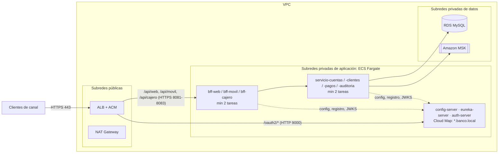

# Guía de despliegue en AWS

> **Aviso:** esta es la **guía de despliegue** en AWS del sistema Banco XYZ. **No se ejecutó en una cuenta de AWS.** La verificación funcional del sistema (incluido el escalado horizontal con réplicas) se hizo en local con **Docker Compose**, como se describe en [instrucciones.md](instrucciones.md). Los comandos de esta guía usan los nombres reales de las imágenes, puertos, variables y endpoints del repositorio. Los valores entre `<...>` (cuenta, región, endpoints, ARN) dependen de cada cuenta. Los precios son aproximados.

## 1. Arquitectura objetivo

| En Docker Compose (local) | En AWS |
|---|---|
| `reverse-proxy` (nginx, TLS passthrough) | **Application Load Balancer** público con HTTPS (certificado de ACM). |
| Contenedores de cada servicio | **Amazon ECS sobre Fargate**: un servicio ECS por módulo, imágenes en **ECR**. |
| `mysql` (contenedor con volumen) | **Amazon RDS for MySQL 8.0**, con las 4 bases. |
| `kafka` (KRaft, 1 nodo) | **Amazon MSK** (2 brokers en 2 zonas de disponibilidad). |
| Secretos `{cipher}` y `encrypt.key` de desarrollo | **AWS Secrets Manager**, inyectado como variables de entorno de las tareas. |
| Logs de `docker compose logs` | **CloudWatch Logs** (driver `awslogs`). |
| `--scale` / `docker-compose.escalado.yaml` | **Application Auto Scaling** de ECS, con mínimo 2 tareas por servicio de negocio y BFF. |
| Nombres de servicio de la red de Compose | **Eureka** (sin cambios) entre servicios, y **AWS Cloud Map** para los nombres fijos de la plataforma. |



## 2. Decisiones

- **Cómputo: ECS Fargate.** No hay servidores que administrar, cada módulo ya tiene su `Dockerfile` y las tareas reciben su propia IP en la VPC (modo `awsvpc`), que es lo que registra Eureka con `EUREKA_INSTANCE_PREFER_IP_ADDRESS=true`. La alternativa, EC2 con Docker Compose, sirve para una demo, pero no da escalado automático ni reemplazo de tareas caídas.
- **Service discovery: se mantiene Eureka y se agrega Cloud Map solo para la plataforma.** Justificación:
  - El código ya usa Eureka + Spring Cloud LoadBalancer con nombres lógicos (`http://servicio-cuentas`, `http://servicio-clientes`), y en local se probaron con réplicas el reparto, la caída de una réplica, el Retry y el Circuit Breaker.
  - Pasar a Cloud Map exigiría quitar el cliente Eureka y cambiar la resolución en todos los servicios, sin ganar funcionalidad.
  - Lo que sí necesita un nombre fijo antes de que exista Eureka es `config-server`, `eureka-server` y `auth-server` (`CONFIG_SERVER_URL`, `EUREKA_URL`, `AUTH_SERVER_URL`). Para eso se usa un namespace privado de Cloud Map, `banco.local`, con registros A: `config-server.banco.local`, `eureka-server.banco.local` y `auth-server.banco.local`.
- **Entrada: ALB en lugar de nginx.** nginx solo repartía TCP entre réplicas de los BFF; el ALB hace eso y además termina TLS con un certificado de ACM, enruta por ruta y hace health checks. El ALB vuelve a cifrar hacia los BFF, que siguen sirviendo HTTPS con su `keystore.p12` (el ALB acepta el certificado autofirmado del destino), así que el tráfico va cifrado de punta a punta.

## 3. Red: VPC, subredes y security groups

1. **VPC** `10.0.0.0/16` en 2 zonas de disponibilidad, por ejemplo `<region>a` y `<region>b`.
2. **Subredes:**
   - públicas `10.0.0.0/24` y `10.0.1.0/24`: ALB y NAT Gateway;
   - privadas de aplicación `10.0.10.0/24` y `10.0.11.0/24`: tareas ECS;
   - privadas de datos `10.0.20.0/24` y `10.0.21.0/24`: RDS y MSK.
3. **Salida a internet de las tareas** (descargar imágenes de ECR, CloudWatch, Secrets Manager): un NAT Gateway, o VPC endpoints de `ecr.api`, `ecr.dkr`, `s3` (gateway), `logs` y `secretsmanager`, que evitan el costo de datos del NAT.

**Security groups** (todas las reglas de entrada son por referencia a otro security group, salvo la del ALB):

| Security group | Componentes | Entrada | Origen |
|---|---|---|---|
| `sg-alb` | ALB | TCP 443 (y 80, solo para redirigir a 443) | `0.0.0.0/0` |
| `sg-bff` | `bff-web`, `bff-movil`, `bff-cajero` | TCP 8081, 8082, 8083 | `sg-alb` |
| `sg-auth` | `auth-server` | TCP 9000 | `sg-alb`, `sg-bff`, `sg-servicios` |
| `sg-plataforma` | `config-server`, `eureka-server` | TCP 8888 y 8761 | `sg-bff`, `sg-servicios`, `sg-auth` (solo 8888) |
| `sg-servicios` | `servicio-cuentas`, `servicio-clientes`, `servicio-pagos`, `servicio-auditoria` | TCP 8080 (cuentas) desde BFF y servicios; TCP 8085, 8086, 8084 entre servicios | `sg-bff` (solo 8080), `sg-servicios` (autorreferencia) |
| `sg-rds` | RDS MySQL | TCP 3306 | `sg-servicios` (y un bastión o tarea de administración para cargar los scripts) |
| `sg-msk` | MSK | TCP 9092 (texto plano en la VPC) o 9094 (TLS) | `sg-servicios` |

Salidas: se puede dejar la salida por defecto (todo permitido), o restringirla a los puertos anteriores más 443 hacia los VPC endpoints y el NAT.

## 4. Imágenes en ECR

Hay 10 imágenes, una por módulo ejecutable. Todos los `Dockerfile` usan la raíz del repositorio como contexto, igual que `docker-compose.yaml`.

```bash
REGION=<region>                 # por ejemplo us-east-1
CUENTA=<id-de-cuenta-aws>
REGISTRO=$CUENTA.dkr.ecr.$REGION.amazonaws.com
MODULOS="config-server eureka-server auth-server servicio-cuentas servicio-clientes servicio-pagos servicio-auditoria bff-web bff-movil bff-cajero"

aws ecr get-login-password --region $REGION | docker login --username AWS --password-stdin $REGISTRO

for m in $MODULOS; do
  aws ecr create-repository --repository-name banco/$m --region $REGION >/dev/null 2>&1 || true
  docker build --platform linux/amd64 -f $m/Dockerfile -t banco/$m:latest .
  docker tag banco/$m:latest $REGISTRO/banco/$m:latest
  docker push $REGISTRO/banco/$m:latest
done
```

`--platform linux/amd64` coincide con la arquitectura por defecto de Fargate (X86_64), aunque se construya en un equipo ARM. En un despliegue real conviene etiquetar con el hash del commit (`git rev-parse --short HEAD`) en lugar de `latest`.

## 5. Base de datos: Amazon RDS for MySQL

1. **Crear la instancia:** `db-subnet-group` con las subredes privadas de datos, `sg-rds`, MySQL 8.0. Para pruebas, `db.t4g.micro`; para producción, Multi-AZ.
2. **Credenciales en Secrets Manager**, en vez de la contraseña de desarrollo de `docker-compose.yaml`: crear el usuario maestro con `--manage-master-user-password` (RDS guarda el secreto en Secrets Manager) o crear un secreto propio, por ejemplo `banco/mysql` con `username` y `password`.
3. **Crear las bases y cargar los datos** desde un bastión o una tarea de administración con cliente `mysql`. En Compose, `banco_xyz` la creaba `MYSQL_DATABASE`; en RDS hay que crearla primero:

```bash
mysql -h <endpoint-rds> -u <usuario> -p -e "CREATE DATABASE IF NOT EXISTS banco_xyz"
mysql -h <endpoint-rds> -u <usuario> -p < db/init/00-crear-bases.sql            # banco_clientes, banco_pagos, banco_auditoria
mysql -h <endpoint-rds> -u <usuario> -p banco_xyz < db/init/01-datos.sql        # datos iniciales de cuentas
mysql -h <endpoint-rds> -u <usuario> -p banco_xyz < db/init/02-batch-schema.sql # tablas BATCH_* de Spring Batch
```

Las tablas de cada servicio las crea Hibernate al arrancar (`spring.jpa.hibernate.ddl-auto=update`).

4. **Credenciales en las tareas:** se inyectan con el bloque `secrets` de la task definition, como variables `SPRING_DATASOURCE_USERNAME` y `SPRING_DATASOURCE_PASSWORD`.

> **Cambio obligatorio en `config-repo`:** hoy `servicio-cuentas.properties`, `servicio-clientes.properties`, `servicio-pagos.properties` y `servicio-auditoria.properties` definen `spring.datasource.password={cipher}...`. Los valores que entrega el Config Server tienen **más prioridad que las variables de entorno** de la tarea, así que hay que quitar esa línea en la imagen de `config-server` que se despliegue en AWS. Si no, se usaría la contraseña de desarrollo. Lo mismo aplica a cualquier secreto que se quiera mover de `config-repo` a Secrets Manager.

**Otros secretos:**
- **`config-server`:** su clave de cifrado (`encrypt.key` en `config-server/src/main/resources/application.properties`) se reemplaza por la variable `ENCRYPT_KEY`, desde Secrets Manager, con un valor nuevo.
- **Secretos OAuth y del keystore:** los `{cipher}` de los clientes OAuth (`auth-server.properties`) y de `server.ssl.key-store-password` (`bff-*.properties`) se vuelven a cifrar con esa clave nueva, usando `POST /encrypt` del propio Config Server desde dentro de la VPC.

## 6. Kafka: Amazon MSK

1. **Crear el cluster** MSK provisionado: 2 brokers `kafka.t3.small` (pruebas) en las subredes privadas de datos, con `sg-msk`.
   - Opción más simple dentro de la VPC: cifrado en tránsito "TLS o texto plano" y puerto 9092.
   - Solo TLS: puerto 9094, y agregar a las tareas `SPRING_KAFKA_SECURITY_PROTOCOL=SSL`.
2. **Obtener los bootstrap brokers:**
   ```bash
   aws kafka get-bootstrap-brokers --cluster-arn <arn-msk>
   ```
3. **Cambiar el bootstrap en las tareas:** `SPRING_KAFKA_BOOTSTRAP_SERVERS=b-1.<cluster>...:9092,b-2.<cluster>...:9092` en `servicio-cuentas`, `servicio-pagos` y `servicio-auditoria`, en lugar de `kafka:9092`.
4. **Tópicos:** los crean las aplicaciones al arrancar (beans `NewTopic` / `KafkaAdmin.NewTopics`), con 2 particiones y factor de replicación 1:
   - `retiros-realizados`, `transacciones-completadas`, `alertas-seguridad`;
   - sus `.DLT`.

   En MSK conviene crearlos antes con factor de replicación 2 (si ya existen, `KafkaAdmin` no los modifica):
   ```bash
   for t in retiros-realizados transacciones-completadas alertas-seguridad \
            retiros-realizados.DLT transacciones-completadas.DLT alertas-seguridad.DLT; do
     kafka-topics.sh --bootstrap-server <bootstrap> --create --if-not-exists --topic $t --partitions 2 --replication-factor 2
   done
   ```
   Alternativa más barata para pruebas: Kafka en una instancia EC2 (por ejemplo la imagen `apache/kafka` en modo KRaft, como en Compose), con el mismo cambio de `SPRING_KAFKA_BOOTSTRAP_SERVERS`.

## 7. ECS Fargate: cluster, Cloud Map y servicios

1. Crear el cluster `banco-xyz` con Container Insights habilitado.
2. Crear el namespace privado de Cloud Map `banco.local` asociado a la VPC.
3. Crear un rol de ejecución de tareas (`ecsTaskExecutionRole`) con permisos para ECR, CloudWatch Logs y lectura de los secretos usados.
4. Crear una task definition y un servicio ECS por módulo (`networkMode: awsvpc`, subredes privadas de aplicación, sin IP pública).

**Tamaño y conteo** (equivalente a los `mem_limit` y `cpus` de `docker-compose.yaml`; las combinaciones son las válidas en Fargate):

| Servicio ECS | Puerto | Task CPU / memoria | `JAVA_TOOL_OPTIONS` | Tareas (mín–máx) | Cloud Map | Target group ALB |
|---|---|---|---|---|---|---|
| `config-server` | 8888 | 0.25 vCPU / 512 MB | `-Xmx256m` | 1–1 (ver sección 12) | `config-server.banco.local` | — |
| `eureka-server` | 8761 | 0.25 vCPU / 512 MB | `-Xmx256m` | 1–1 | `eureka-server.banco.local` | — |
| `auth-server` | 9000 | 0.25 vCPU / 512 MB | `-Xmx256m` | 1–1 | `auth-server.banco.local` | `tg-auth` (HTTP) |
| `servicio-cuentas` | 8080 | 0.5 vCPU / 1 GB | `-Xmx384m` | 2–4 | — | — |
| `servicio-clientes` | 8085 | 0.5 vCPU / 1 GB | `-Xmx256m` | 2–4 | — | — |
| `servicio-pagos` | 8086 | 0.5 vCPU / 1 GB | `-Xmx256m` | 2–4 | — | — |
| `servicio-auditoria` | 8084 | 0.5 vCPU / 1 GB | `-Xmx256m` | 2–2 (los tópicos tienen 2 particiones) | — | — |
| `bff-web` | 8081 | 0.5 vCPU / 1 GB | `-Xmx256m` | 2–6 | — | `tg-bff-web` (HTTPS) |
| `bff-movil` | 8082 | 0.5 vCPU / 1 GB | `-Xmx256m` | 2–6 | — | `tg-bff-movil` (HTTPS) |
| `bff-cajero` | 8083 | 0.5 vCPU / 1 GB | `-Xmx256m` | 2–6 | — | `tg-bff-cajero` (HTTPS) |

**Health check del contenedor** (los mismos de Compose; las imágenes `eclipse-temurin` incluyen `curl`):
- Servicios: `CMD-SHELL curl -fsS http://127.0.0.1:<puerto>/actuator/health/readiness`.
- BFF: `CMD-SHELL curl -kfsS https://127.0.0.1:<puerto>/actuator/health/readiness`.
- `config-server`, `eureka-server` y `auth-server` no tienen actuator. En Compose se verifican por TCP con `bash -c '</dev/tcp/127.0.0.1/<puerto>'`, comando que también sirve en ECS.

En todos, `startPeriod` de 90 segundos.

### Variables de entorno por servicio

Son las mismas de `docker-compose.yaml`, cambiando los nombres de servicio de Compose por los de Cloud Map, RDS y MSK:

| Variable | Valor en AWS | Servicios |
|---|---|---|
| `JAVA_TOOL_OPTIONS` | ver la tabla anterior | todos los Java |
| `CONFIG_SERVER_URL` | `http://config-server.banco.local:8888` | auth-server, servicios y BFF |
| `EUREKA_URL` | `http://eureka-server.banco.local:8761/eureka/` | servicios y BFF |
| `EUREKA_INSTANCE_PREFER_IP_ADDRESS` | `true` | servicios y BFF |
| `AUTH_SERVER_URL` | `http://auth-server.banco.local:9000` | servicios y BFF (base de `jwk-set-uri` y `token-uri` en `config-repo`) |
| `SPRING_SECURITY_OAUTH2_RESOURCESERVER_JWT_JWKSETURI` | `http://auth-server.banco.local:9000/oauth2/jwks` | `bff-web`, `bff-movil`, `bff-cajero` |
| `SPRING_DATASOURCE_URL` | `jdbc:mysql://<endpoint-rds>:3306/banco_xyz` | `servicio-cuentas` |
|  | `jdbc:mysql://<endpoint-rds>:3306/banco_clientes` | `servicio-clientes` |
|  | `jdbc:mysql://<endpoint-rds>:3306/banco_pagos` | `servicio-pagos` |
|  | `jdbc:mysql://<endpoint-rds>:3306/banco_auditoria` | `servicio-auditoria` |
| `SPRING_DATASOURCE_USERNAME` / `SPRING_DATASOURCE_PASSWORD` | desde Secrets Manager (`secrets`) | los 4 servicios con base |
| `SPRING_KAFKA_BOOTSTRAP_SERVERS` | bootstrap de MSK | `servicio-cuentas`, `servicio-pagos`, `servicio-auditoria` |
| `ENCRYPT_KEY` | desde Secrets Manager | `config-server` |

Fragmento de task definition (JSON) para `servicio-pagos`:

```json
{
  "family": "servicio-pagos",
  "requiresCompatibilities": ["FARGATE"],
  "networkMode": "awsvpc",
  "cpu": "512",
  "memory": "1024",
  "executionRoleArn": "arn:aws:iam::<cuenta>:role/ecsTaskExecutionRole",
  "containerDefinitions": [{
    "name": "servicio-pagos",
    "image": "<cuenta>.dkr.ecr.<region>.amazonaws.com/banco/servicio-pagos:latest",
    "portMappings": [{ "containerPort": 8086, "protocol": "tcp" }],
    "environment": [
      { "name": "JAVA_TOOL_OPTIONS", "value": "-Xmx256m" },
      { "name": "CONFIG_SERVER_URL", "value": "http://config-server.banco.local:8888" },
      { "name": "EUREKA_URL", "value": "http://eureka-server.banco.local:8761/eureka/" },
      { "name": "EUREKA_INSTANCE_PREFER_IP_ADDRESS", "value": "true" },
      { "name": "AUTH_SERVER_URL", "value": "http://auth-server.banco.local:9000" },
      { "name": "SPRING_DATASOURCE_URL", "value": "jdbc:mysql://<endpoint-rds>:3306/banco_pagos" },
      { "name": "SPRING_KAFKA_BOOTSTRAP_SERVERS", "value": "<bootstrap-msk>" }
    ],
    "secrets": [
      { "name": "SPRING_DATASOURCE_USERNAME", "valueFrom": "<arn-secreto-mysql>:username::" },
      { "name": "SPRING_DATASOURCE_PASSWORD", "valueFrom": "<arn-secreto-mysql>:password::" }
    ],
    "healthCheck": {
      "command": ["CMD-SHELL", "curl -fsS http://127.0.0.1:8086/actuator/health/readiness || exit 1"],
      "interval": 10, "timeout": 5, "retries": 5, "startPeriod": 90
    },
    "logConfiguration": {
      "logDriver": "awslogs",
      "options": {
        "awslogs-group": "/ecs/banco-xyz/servicio-pagos",
        "awslogs-region": "<region>",
        "awslogs-stream-prefix": "ecs"
      }
    }
  }]
}
```

Al crear los servicios conviene activar `enableExecuteCommand` (ECS Exec), que permite abrir un shell en una tarea para las verificaciones de la sección 10.

## 8. Application Load Balancer (reemplaza a nginx)

1. **Certificado** en ACM para el dominio público, por ejemplo `api.<dominio>`, validado por DNS.
2. **ALB** público en las subredes públicas, con `sg-alb`:
   - listener HTTPS 443 con el certificado de ACM;
   - listener HTTP 80 que redirige a 443.
3. **Target groups**, todos con tipo de destino `ip`:

| Target group | Protocolo y puerto del destino | Health check |
|---|---|---|
| `tg-bff-web` | HTTPS 8081 | HTTPS `/actuator/health/readiness`, código 200 |
| `tg-bff-movil` | HTTPS 8082 | HTTPS `/actuator/health/readiness`, código 200 |
| `tg-bff-cajero` | HTTPS 8083 | HTTPS `/actuator/health/readiness`, código 200 |
| `tg-auth` | HTTP 9000 | HTTP `/oauth2/jwks`, código 200 (auth-server no tiene actuator; ese endpoint es público) |

En los BFF, `/actuator/health/readiness` está abierto sin token y sin detalles.

4. **Reglas del listener 443:**
   - `/api/web/*` → `tg-bff-web`
   - `/api/movil/*` → `tg-bff-movil`
   - `/api/cajero/*` → `tg-bff-cajero`
   - `/oauth2/*` → `tg-auth`
   - por defecto: respuesta fija 404.
5. **Deregistration delay** de los target groups: 30 s, para que las conexiones en curso terminen al reemplazar tareas.

Con esto los clientes usan una sola URL, `https://api.<dominio>`, con certificado válido; ya no hacen falta `-k` ni los puertos 8081-8083. Eureka, Config Server, Kafka, RDS y los servicios de negocio no se exponen a internet.

## 9. Escalado horizontal y logs

**Auto Scaling** por servicio ECS (Application Auto Scaling, con los mínimos y máximos de la sección 7):

```bash
aws application-autoscaling register-scalable-target --service-namespace ecs \
  --resource-id service/banco-xyz/servicio-pagos --scalable-dimension ecs:service:DesiredCount \
  --min-capacity 2 --max-capacity 4

aws application-autoscaling put-scaling-policy --service-namespace ecs \
  --resource-id service/banco-xyz/servicio-pagos --scalable-dimension ecs:service:DesiredCount \
  --policy-name cpu-60 --policy-type TargetTrackingScaling \
  --target-tracking-scaling-policy-configuration \
  '{"TargetValue":60,"PredefinedMetricSpecification":{"PredefinedMetricType":"ECSServiceAverageCPUUtilization"},"ScaleOutCooldown":60,"ScaleInCooldown":120}'
```

Se agrega una segunda política igual con `ECSServiceAverageMemoryUtilization` y objetivo 70 %, y se repite para cuentas, clientes y los BFF.

Lo que ya resuelve el código para correr con varias tareas, y que se probó en local con 2 réplicas:
- reparto con Eureka + LoadBalancer, con el registro y la caché del LoadBalancer refrescando cada 5 s;
- idempotencia de pagos y de movimientos de cuentas entre réplicas;
- un solo `JobExecution` por job y fecha (JobRepository JDBC compartido en RDS);
- consumo de Kafka sin duplicados (grupo `auditoria`, restricción única por tópico, partición y offset);
- reconciliador de pagos idempotente.

`servicio-auditoria` no escala más allá del número de particiones (2).

**Logs:** cada contenedor envía stdout a CloudWatch Logs en `/ecs/banco-xyz/<servicio>`. Conviene fijar 14 días de retención y crear alarmas de CloudWatch para:
- `HTTPCode_Target_5XX_Count` y `UnHealthyHostCount` del ALB;
- CPU y memoria de los servicios ECS;
- filtros de métricas sobre los logs de `servicio-pagos` con `REQUIERE_REVISION` y `requiere intervencion manual`, que son los pagos que piden intervención manual.

## 10. Orden de despliegue y verificación

**Orden**, equivalente a los `depends_on` de Compose:
1. VPC, subredes, NAT o VPC endpoints, y security groups.
2. Secretos en Secrets Manager.
3. RDS, y la carga de `db/init/` (sección 5).
4. MSK, y la creación de tópicos (sección 6).
5. Repositorios ECR, y el build y push de las 10 imágenes (sección 4).
6. Cluster ECS, namespace Cloud Map y log groups.
7. `config-server` → `eureka-server` → `auth-server`. Esperar a que cada uno esté `RUNNING` y sano.
8. `servicio-clientes` y `servicio-auditoria` → `servicio-cuentas` → `servicio-pagos`.
9. `bff-web`, `bff-movil` y `bff-cajero`, y por último el ALB con sus reglas.

**Verificación post-despliegue:**
1. En ECS, todos los servicios con sus tareas `RUNNING` y sanas; en EC2 → Target Groups, todos los destinos `healthy`.
2. **Registro en Eureka**, desde un shell en una tarea (ECS Exec):
   ```bash
   aws ecs execute-command --cluster banco-xyz --task <id-tarea-pagos> --container servicio-pagos --interactive --command "sh"
   curl -s -H "Accept: application/json" http://eureka-server.banco.local:8761/eureka/apps
   ```
   Debe haber al menos 2 instancias UP de cada servicio de negocio y BFF.
3. **Token y canal**, desde fuera:
   ```bash
   curl -s -u cajero-client:<secreto> -d grant_type=client_credentials -d scope=cajero https://api.<dominio>/oauth2/token
   curl -H "Authorization: Bearer <token>" https://api.<dominio>/api/cajero/cuentas/108/saldo
   ```
   El secreto sale de Secrets Manager, o del Config Server desde dentro de la VPC.
4. **Servicios internos, idempotencia, auditoría y batch:** desde el shell de la tarea, los mismos comandos de la sección 6 de [instrucciones.md](instrucciones.md), cambiando `config-server` y `auth-server` por `config-server.banco.local` y `auth-server.banco.local`. Por ejemplo, un depósito repetido con la misma `Idempotency-Key` devuelve el mismo pago, y `/api/auditoria/resumen` muestra los eventos en los 3 tópicos.
5. **Escalado:** parar una tarea de `servicio-cuentas` (`aws ecs stop-task`) mientras se consulta el saldo por el canal cajero. El servicio sigue respondiendo y ECS reemplaza la tarea.

## 11. Costos aproximados y limpieza

Estimación mensual **orientativa** en `us-east-1` con los tamaños de la sección 7 (validar con la AWS Pricing Calculator; no incluye transferencia de datos ni impuestos):

| Recurso | Supuesto | Aprox. USD/mes |
|---|---|---|
| ECS Fargate | ~16 tareas: 3 de 0.25 vCPU/0.5 GB y 13 de 0.5 vCPU/1 GB, 24×7 | ~ 260 |
| RDS MySQL | `db.t4g.micro`, Single-AZ, 20 GB gp3 | ~ 15 |
| Amazon MSK | 2 × `kafka.t3.small` + almacenamiento | ~ 70 |
| ALB | 1 ALB con poco tráfico | ~ 20 |
| NAT Gateway | 1 NAT (sin contar datos) | ~ 33 |
| CloudWatch, ECR, Secrets Manager | logs, imágenes, ~5 secretos | ~ 10 |
| **Total** | | **~ 400** |

Para una demo, el costo baja con 1 tarea por servicio, Kafka en una EC2 pequeña, VPC endpoints en vez de NAT, o apagando todo al terminar.

**Limpieza**, en orden inverso para no dejar recursos cobrando:
1. Servicios ECS (`desiredCount=0`, luego `delete-service`), cluster y namespace de Cloud Map.
2. ALB y target groups.
3. Cluster MSK.
4. Instancia RDS (con o sin snapshot final).
5. NAT Gateway, Elastic IP y VPC endpoints.
6. Repositorios ECR (`aws ecr delete-repository --repository-name banco/<modulo> --force`).
7. Log groups `/ecs/banco-xyz/*` y secretos.
8. VPC.

## 12. Límites y cómo mitigarlos en AWS

| Límite | Por qué | Mitigación |
|---|---|---|
| `auth-server` con 1 sola tarea | Genera su par de claves RSA en memoria al arrancar: con 2 tareas, cada una firmaría con una clave distinta y el JWKS de una no validaría los tokens de la otra. Al reiniciarse, los tokens anteriores dejan de validar (los servicios renuevan el suyo solos ante un 401; los clientes de canal deben pedir otro). | Cargar la clave desde Secrets Manager o KMS en vez de generarla (cambio en `AuthorizationServerConfig`) y luego correr 2 o más tareas detrás de `tg-auth`. Alternativa: reemplazarlo por Amazon Cognito (client credentials), adaptando los scopes. |
| `eureka-server` con 1 sola tarea | Está configurado en modo standalone (`register-with-eureka=false`, `fetch-registry=false`). | ECS lo reinicia solo si cae, y mientras tanto los clientes siguen usando el registro que tienen en caché. Para alta disponibilidad: 2 servicios ECS (`eureka-a`, `eureka-b`) configurados como peers que se replican entre sí, o migrar el descubrimiento a Cloud Map (cambio de código en todos los clientes). |
| `config-server` con 1 tarea | La configuración solo se lee al arrancar cada servicio: si está caído, las tareas nuevas (escalado o reemplazo) no arrancan. | Como sirve `config-repo` desde el classpath y no guarda estado, se puede correr con 2 tareas registradas en el mismo nombre de Cloud Map (respuesta DNS con varias IP). Cambiar la configuración exige reconstruir su imagen; una alternativa es el backend de Git o el de AWS Secrets Manager / Parameter Store de Spring Cloud Config. |
| Tópicos con factor de replicación 1 | Los `NewTopic` del código usan `replicas(1)`. | Crear los tópicos antes con factor 2 o 3 en MSK (sección 6), o cambiar `replicas(...)` en `KafkaTopicConfig` y `KafkaConfig`. |
| Eventos perdidos con Kafka caído | El productor descarta el evento tras agotar `delivery.timeout.ms`; el pago queda bien, pero sin auditoría. | MSK Multi-AZ reduce mucho las caídas; la solución completa es un *outbox* transaccional en `servicio-pagos`. |
| Secretos de desarrollo en el repositorio | `encrypt.key`, la contraseña de MySQL de Compose y los `{cipher}` actuales son de desarrollo. | Valores nuevos en Secrets Manager (sección 5) y quitar los secretos de `config-repo` que pasen a variables de entorno. |
