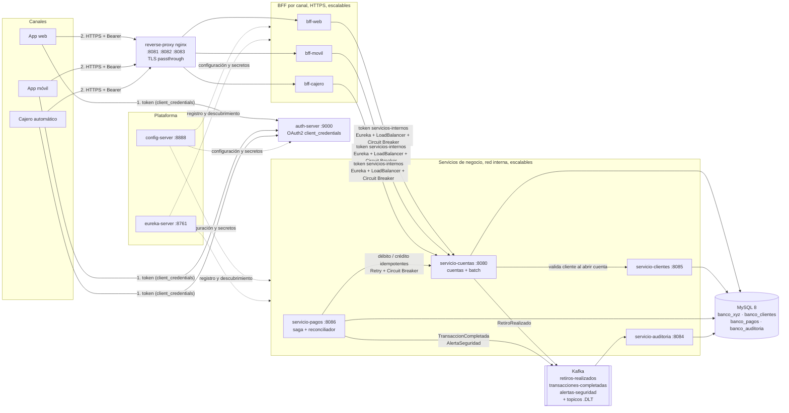

# Banco XYZ – Arquitectura de microservicios con Spring Cloud

Sistema bancario del Banco XYZ construido como microservicios con Spring Boot 4 y Spring Cloud. Cubre la gestión de clientes y cuentas, los pagos (retiros, depósitos y transferencias), la auditoría de eventos y los procesos batch heredados, y atiende a tres canales (web, móvil y cajero automático) a través de un Backend for Frontend (BFF) por canal.

El sistema completo se levanta con Docker Compose y admite varias réplicas de los servicios de negocio y de los BFF.

- **Cómo compilar, ejecutar y probar:** [instrucciones.md](instrucciones.md)
- **Guía de despliegue en AWS:** [despliegue.md](despliegue.md)

## Arquitectura



**Flujo de una petición:**
1. El cliente del canal pide un token a `auth-server`, con el flujo `client_credentials` y el scope de su canal.
2. Llama por HTTPS al puerto de su canal en nginx (`reverse-proxy`), que reparte la conexión entre las réplicas del BFF.
3. El BFF valida el token y llama a los servicios internos con su propio token `servicios-internos`, que tiene el scope `interno`. Encuentra las instancias por su nombre lógico en Eureka y Spring Cloud LoadBalancer reparte las llamadas entre ellas.
4. Los servicios publican eventos en Kafka, y `servicio-auditoria` los guarda.

## Módulos

El `pom.xml` de la raíz es el POM agregador (Java 17, Spring Boot 4.1.0, Spring Cloud 2025.1.2) y declara 11 módulos Maven. Docker Compose agrega `mysql`, `kafka` y `reverse-proxy` (nginx), así que suma 13 servicios.

| Módulo / servicio | Puerto | Expuesto al host | Responsabilidad |
|---|---|---|---|
| `config-server` | 8888 | Sí | Configuración centralizada (perfil `native`, `config-repo/`). Entrega los secretos `{cipher}` ya descifrados. |
| `eureka-server` | 8761 | Sí | Registro y descubrimiento de servicios. |
| `auth-server` | 9000 | Sí | Authorization Server OAuth2. Emite JWT RS256 con `client_credentials` para los clientes `web-client`, `movil-client`, `cajero-client` y `servicios-internos`. |
| `reverse-proxy` (nginx) | 8081, 8082, 8083 | Sí | Único punto de entrada de los canales. Proxy TCP con TLS passthrough que reparte entre las réplicas de cada BFF. |
| `bff-web` | 8081 | No (vía nginx) | BFF del canal web (HTTPS, scope `web`): cuenta con estado anual, movimientos y transacciones. |
| `bff-movil` | 8082 | No (vía nginx) | BFF del canal móvil (HTTPS, scope `movil`): datos esenciales de la cuenta y últimos 10 movimientos. |
| `bff-cajero` | 8083 | No (vía nginx) | BFF del cajero (HTTPS, scope `cajero`): saldo, validación de cuenta y retiro. |
| `servicio-cuentas` | 8080 | No | Cuentas: consulta, apertura, mantenimiento, cierre, débito y crédito idempotentes. Incluye los 3 jobs de Spring Batch, que se disparan por endpoint. Base `banco_xyz`. |
| `servicio-clientes` | 8085 | No | CRUD de clientes, perfiles (BASICO, PREFERENTE, PREMIUM) y baja lógica. Base `banco_clientes`. |
| `servicio-pagos` | 8086 | No | Retiros, depósitos y transferencias (saga con compensación), `Idempotency-Key`, eventos Kafka y reconciliador de pagos inciertos. Base `banco_pagos`. |
| `servicio-auditoria` | 8084 | No | Consume los 3 tópicos de Kafka, guarda los eventos y los expone en una API de consulta. Envía a `<tópico>.DLT` los mensajes que no puede procesar. Base `banco_auditoria`. |
| `seguridad-interna` | — | — | Librería compartida: token `servicios-internos` con caché y renovación, e interceptor de `RestClient` (Bearer, más un reintento ante 401). |
| `mysql` | 3306 (host 3307) | Sí | MySQL 8, con una base por servicio. `db/init/` crea las bases, los datos iniciales y las tablas de Spring Batch. |
| `kafka` | 9092 | No | Apache Kafka en modo KRaft, con un solo nodo. |

## Stack

- **Lenguaje y build:** Java 17 y Maven multi-módulo con wrapper (`mvnw` / `mvnw.cmd`).
- **Spring:** Spring Boot 4.1.0, Spring Cloud 2025.1.2 (Config Server, Netflix Eureka, LoadBalancer, Circuit Breaker Resilience4j), Spring Security 7 (Authorization Server y Resource Server), Spring Data JPA (Hibernate), Spring Batch 6 (JobRepository JDBC) y Spring Kafka.
- **Infraestructura:** MySQL 8, Apache Kafka (KRaft), nginx 1.28, Docker y Docker Compose.
- **Pruebas:** JUnit 5, Mockito, AssertJ y `MockRestServiceServer`.

## Cómo se resuelve cada requisito de negocio

| Requisito | Solución |
|---|---|
| Gestión de clientes y perfiles | `servicio-clientes`: alta, consulta (por id y por RUT), actualización, cambio de perfil y baja lógica (estado INACTIVO). Valida los datos con Jakarta Validation; un RUT o email duplicado responde 409. |
| Apertura, mantenimiento y cierre de cuentas | `servicio-cuentas`: la apertura valida en `servicio-clientes` que el cliente exista y esté ACTIVO. El cierre exige saldo 0. Una cuenta CERRADA rechaza débitos, créditos y retiros con 409. |
| Retiros, depósitos y transferencias | `servicio-pagos`: saga débito → crédito y, si el crédito falla, compensación (devolución al origen). Estados PENDIENTE, COMPLETADO, FALLIDO, COMPENSADO y REQUIERE_REVISION. |
| Operaciones sin duplicados | Header `Idempotency-Key` en los POST de pagos: la misma clave devuelve el resultado original y otro cuerpo con la misma clave responde 422. Hacia cuentas, cada movimiento lleva la clave `pago-<id>-<operación>`, guardada en `movimientos_idempotentes`. |
| Consistencia del dinero ante fallas | `ReconciliadorPagos` (cada 10 s) resuelve los pagos de resultado incierto preguntando a cuentas si el movimiento se aplicó: si no se aplicó, cuentas lo anula para siempre; si se aplicó, se completa o se revierte. |
| Canales web, móvil y cajero | Un BFF por canal, cada uno con su scope OAuth2 y su respuesta adaptada; nginx expone un puerto por canal. |
| Seguridad | OAuth2 en el borde (un scope por canal) y entre servicios (scope `interno`), con JWT RS256 validados por JWKS. Secretos cifrados en el Config Server y HTTPS en los BFF. Pagos, clientes, cuentas y auditoría no publican puertos. |
| Auditoría y alertas | Eventos `RetiroRealizado`, `TransaccionCompletada` y `AlertaSeguridad` (OPERACION_RECHAZADA, COMPENSACION_EJECUTADA, REQUIERE_REVISION, MONTO_ELEVADO). Se persisten en `servicio-auditoria` sin duplicados (restricción única por tópico, partición y offset). |
| Procesos batch heredados | `transaccionesJob`, `interesesJob` y `cuentasAnualesJob` (particionamiento, multithreading, SkipPolicy, RetryPolicy). Se disparan con `POST /api/core/batch/{job}?fecha=` y se ejecutan una sola vez por job y fecha entre todas las réplicas; no alteran saldos existentes. |
| Resiliencia | Circuit Breaker en BFF → cuentas. Retry con backoff solo ante "no disponible" y Circuit Breaker en pagos → cuentas y en cuentas → clientes. Timeouts explícitos, DLT en Kafka y reconciliador de pagos. |
| Escalabilidad | Réplicas de cuentas, clientes, pagos, auditoría y BFF (`--scale` o `docker-compose.escalado.yaml`). Las reparten Eureka + LoadBalancer entre servicios y nginx hacia los BFF. Cada servicio tiene límites de CPU y memoria, y healthcheck `readiness`. |

## Legacy vs nueva arquitectura

El historial de Git conserva dos estados anteriores:
- **Batch inicial** (commit `d665378`, "S1 y S2"): una sola aplicación Spring Batch.
- **Core monolítico con BFF** (rama `backup-pre-microservicios`, commit `c8a9917`): un `core-bancario` que concentraba todo el negocio, más los BFF y la plataforma Spring Cloud.

| Aspecto | Batch inicial (`d665378`) | Core monolítico (`backup-pre-microservicios`) | Arquitectura actual (`main`) |
|---|---|---|---|
| Estructura | Una aplicación Spring Batch con 3 jobs. | Maven multi-módulo: `core-bancario` con todo el negocio y los batch, 3 BFF, config, eureka, auth y auditoría. | El core se dividió en `servicio-cuentas`, `servicio-clientes`, `servicio-pagos` y `servicio-auditoria`, más la librería `seguridad-interna` y nginx. |
| Clientes | No existían. | No existían. | `servicio-clientes`: CRUD, perfiles y baja lógica. |
| Cuentas | Tabla cargada por `interesesJob`. | Consulta, movimientos y retiro en `core-bancario`. | Además apertura (con validación del cliente), mantenimiento, cierre con estado ACTIVA/CERRADA, y débito/crédito idempotentes con bloqueo pesimista. |
| Pagos | — | Solo el retiro directo en core. | `servicio-pagos`: retiro, depósito y transferencia con saga y compensación, `Idempotency-Key` y reconciliador. |
| Datos | MySQL, base única. | Base única `banco_xyz`. | Una base por servicio: `banco_xyz` (cuentas y batch), `banco_clientes`, `banco_pagos` y `banco_auditoria`. |
| Mensajería | — | Kafka: tópico `retiros-realizados`; la auditoría solo escribía en el log. | 3 tópicos más sus `.DLT`; auditoría persistente con API, reintentos y DLT. |
| Seguridad | Sin API; contraseña de MySQL en texto plano en `application.properties`. | OAuth2 en los BFF; secretos cifrados en el Config Server; core sin autenticación (solo red interna). | Además todos los servicios son resource servers con scope `interno`, y los BFF y servicios usan el cliente `servicios-internos`. |
| Resiliencia | SkipPolicy y RetryPolicy en los jobs. | Circuit Breaker BFF → core. | Además Retry y Circuit Breaker en pagos → cuentas y cuentas → clientes, idempotencia, DLT y reconciliación. |
| Batch | 3 jobs que se ejecutaban al arrancar la aplicación (`spring.batch.job.enabled=true`). | Los mismos jobs dentro de core, sin forma de dispararlos (solo con un flag de arranque) y con JobRepository en memoria. | Se disparan por endpoint, con JobRepository JDBC compartido (una ejecución por job y fecha entre réplicas). El writer conserva saldo, estado y cliente de las cuentas existentes. |
| Despliegue | Ejecución local (`java -jar`). | Docker Compose: 10 servicios, una réplica cada uno, BFF con puerto publicado. | 13 servicios; nginx como entrada; réplicas, límites de recursos y healthchecks `readiness`; guía de despliegue en AWS. |

## Estructura del repositorio

```
.
├── readme.md, instrucciones.md, despliegue.md
├── pom.xml                      # POM agregador (11 módulos)
├── docker-compose.yaml          # despliegue normal (1 réplica)
├── docker-compose.escalado.yaml # ejemplo con 2 réplicas de cuentas, pagos y bff-cajero
├── nginx/nginx.conf             # reverse proxy de los canales
├── db/init/                     # 00-crear-bases.sql, 01-datos.sql, 02-batch-schema.sql
├── config-server/src/main/resources/config-repo/   # configuración y secretos {cipher} por servicio
├── seguridad-interna/           # librería compartida (token entre servicios)
├── auth-server/ config-server/ eureka-server/
├── bff-web/ bff-movil/ bff-cajero/
└── servicio-cuentas/ servicio-clientes/ servicio-pagos/ servicio-auditoria/
```

Cada módulo ejecutable tiene su `Dockerfile` multi-stage, que se construye con la raíz del repositorio como contexto.
